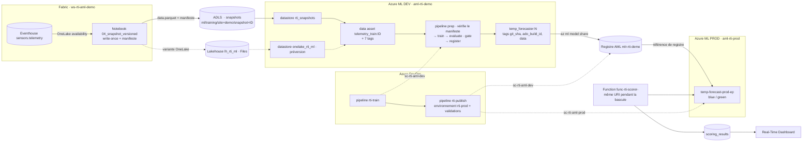

# Brief pour RTI-AML-Agent — Piste C : MLOps DEV → PROD entre deux workspaces Azure ML, piloté par Azure DevOps

> **Demandeur** : the owner · **Date** : 7 octobre 2026 · **Statut** : à cadrer (étape M0)
> **Source** : support « Atelier MLOps #2 — le client » (`Customer_MLOps_Workshop.pptx`) :
> slide 3 (la demande), slide 13 (versionner les données), slide 14 (démo en 6 actes). Les slides 15 à 17 décrivent la cible.
> **Mode d'emploi** : ce fichier est rangé dans `docs/MLOPS-BRIEF.md` du repo. Demander à l'agent :
> « Lis `docs/MLOPS-BRIEF.md`, exécute M0 et arrête-toi pour validation. »

---

## 1. Le besoin en une phrase

Étendre la démo existante (piste A : RTI → AML → endpoint → write-back) pour montrer **le flux MLOps de le client de bout en bout**.
Les données d'entraînement sont figées et versionnées. **Azure DevOps** déclenche l'entraînement dans un workspace **DEV**.
Le modèle est ensuite promu vers un workspace **PROD** via un **registre Azure ML partagé**, avec une **bascule progressive** de l'endpoint.
L'Azure Function qui appelle l'endpoint ne voit **aucune interruption**.

## 2. Pourquoi : ce que le client a demandé (slide 3)

| Source | Contenu |
|---|---|
| Mail d'Anastasia (2 oct.) | Connexion **Data Asset ↔ Datastore ↔ Lakehouse OneLake** : bonnes pratiques pour la mettre en place et la maintenir, limites à connaître, écueils fréquents |
| Document de cadrage | Créer des datasets depuis Fabric, versionner les données ; entraîner à la demande, comparer les modèles ; **mettre à jour l'endpoint sans interrompre la prod** ; **lier les versions data, code et modèle** ; bien utiliser **Azure DevOps** |
| Contraintes | Modèle RL SAC à 5 sorties ; 13 mois au pas de 10 min ; GPU ~1 h–1 h 30 ; réentraînement trimestriel. Réplicable sur d'autres usines (~10 % spécifique). Rétention Eventhouse limitée. **L'endpoint prend 100 % du trafic à chaque déploiement** |

Leur flux actuel (schéma du 2 octobre) :
- Azure Repos, avec un pipeline « training » et un pipeline « publish version ».
- Workspace DEV : data asset → entraînement → modèle → évaluation → register → model registry → endpoint.
- **« copy model »** de DEV vers PROD.
- Workspace PROD : model registry → endpoint en blue/green.

**Message de la démo** : *même flux que le vôtre, avec trois garde-fous* :
- **donnée figée** (snapshot + manifeste) ;
- **registre partagé** (au lieu de la copie de modèle) ;
- **bascule progressive** (au lieu du 100 % immédiat).

> On ne reproduit **pas** leur modèle RL. La démo s'appuie sur `temp_forecaster` (régression sklearn, format MLflow) et sur la télémétrie simulée du repo.
> Le sujet est la **chaîne MLOps**, pas le modèle.

## 3. Ce que la démo doit montrer (slide 14, transposée à ce repo)

| Acte | Durée | Message | Ce qu'on montre ici | Existant réutilisé | À construire |
|---|---|---|---|---|---|
| 1 · Fabric | 4 min | La donnée d'entraînement est figée | `telemetry` en direct. Le notebook de snapshot écrit `snapshot=<id>` (Parquet + manifeste) ; une 2e exécution est refusée (write-once) | Eventhouse, OneLake availability, notebook `01` | notebook `04` write-once + manifeste |
| 2 · Connexion | 4 min | Aucune copie, accès gouverné | Datastore par identité, navigation dans le snapshot, rôle de l'identité du cluster | datastore `rti_snapshots`, identité de `cpu-cluster` | variante OneLake (optionnelle) |
| 3 · Version | 3 min | Un signet versionné, immuable | `telemetry_train:<id>` avec 7 tags ; une réécriture est refusée ; lignage | `telemetry_features:1` | enregistrement depuis le manifeste |
| 4 · Entraînement | 6 min | Reproductible et comparable | Run Azure DevOps `rti-train` → pipeline AML DEV (prep vérifie le manifeste → train → evaluate/gate → register) ; métriques MLflow ; comparaison de 2 runs ; tags Git/ADO | pipeline P4, gate « bat la persistance » | pipeline ADO, tags, vérification du manifeste |
| 5 · Registre | 4 min | Data, code et modèle reliés | `temp_forecaster:N` et ses tags ; partage vers le registre `mlr-rti-demo` ; lien vers le job DEV | registre du workspace | registre AML + étape de partage |
| 6 · PROD | 4 min | Mise à jour sans interruption | Run `rti-publish` (candidate à 0 %, appel direct, miroir 10 %, 90/10, 100 %, retrait) avec validations ADO. Dashboard RTI : `deployment` bascule, 0 erreur | blue/green P7, `41_aml_traffic.ps1`, dashboard | workspace et endpoint PROD, pipeline de publication, bascule de la Function |

Total : 25 min. Le run d'entraînement et le déploiement candidat sont **pré-exécutés la veille**.
En direct, on lance un nouveau run pour montrer le déclenchement, puis on commente le run déjà terminé.

## 4. Convention de versioning des données (slide 13)

Arborescence en écriture unique dans le filesystem `snapshots` (datastore `rti_snapshots`) :

```text
ml/training/
  site=demo/
    snapshot=20261020-0900/      <- version figée (UTC du cutoff), jamais réutilisée
      data.parquet
      _manifest.json             <- écrit EN DERNIER : sa présence = snapshot complet
```

- **Manifeste** : nombre de lignes, bornes min/max de la fenêtre, colonnes, SHA-256 du fichier de données, table source et version Delta au moment du snapshot.
- **Data asset** `telemetry_train`, type `uri_folder`, **version = identifiant du snapshot**.
- **7 tags obligatoires** : `site`, `window_start`, `window_end`, `row_count`, `manifest_sha256`, `source_table`, `source_delta_version`.
- **Règle** : une version de data asset = un dossier figé + un manifeste. Le pipeline **vérifie**, il ne fait pas confiance.
- Un seul site est simulé (`site=demo`). La partition prépare la réplication multi-sites, sans l'implémenter.

## 5. Existant à réutiliser

État connu au 23/09/2026, **à revérifier en M0** (règle 3 : découvrir avant de supposer).

| Brique | Existant (noms exacts) | Usage en piste C |
|---|---|---|
| Socle Azure | `<subscription-name>`, `westus3`, RG `rg-rti-aml-demo` avec l'exemption de policy `exempt-rti-aml-demo` au niveau du RG | inchangé ; la PROD est créée dans ce RG pour bénéficier de l'exemption |
| Fabric | `ws-rti-aml-demo`, Eventhouse `eh-sensors` / KQL DB `sensors`, table `telemetry` avec OneLake availability, capacité `<FABRIC_CAPACITY>` mise en pause entre les sessions | source des snapshots (acte 1) et boucle temps réel (acte 6) |
| Snapshot | `fabric/notebooks/01_snapshot_to_datastore.ipynb` → ADLS `<STORAGE_ACCOUNT>`, `snapshots/telemetry/v{N}` | base du nouveau notebook ; `01` reste intact pour la piste A |
| Datastore | `rti_snapshots` (ADLS Gen2, accès par identité) | datastore par défaut de la piste C |
| Data asset | `telemetry_features:1` | inchangé ; la piste C crée `telemetry_train:<snapshot_id>` |
| Pipeline AML | `aml/pipelines/training_pipeline.yml` (prep → train → evaluate → register, gate « bat la persistance » + `max_mae` 5.0), lancé par `scripts/20_aml_train.ps1` | réutilisé, enrichi de paramètres **optionnels** |
| Modèle | `temp_forecaster` (MLflow, déploiement no-code). v6 = dernière version déployable connue ; v1 et v2 sont indéployables | même nom en DEV et dans le registre |
| Endpoint DEV | `temp-forecast-ep` dans `aml-rti-demo` (`aad_token`, identité système). Au 08/09 : `blue` seul, sur v6, à 100 % | reste l'endpoint de la piste A |
| Scripts d'endpoint | `scripts/30_aml_endpoint.ps1` (`-Workspace`, `-EndpointName`, `-ModelVersion`, `-SkipTraffic`) ; `scripts/41_aml_traffic.ps1` (`-Blue`/`-Green`, `-Mirror`, `-Show`) | appelés par la CI : même code en local et dans Azure DevOps. Deux limites à lever d'abord (R-51, R-53) |
| Function | `func-rti-scorer-<SUFFIX>` : timer 30 s, appelle `AML_SCORING_URI`, lit l'en-tête `azureml-model-deployment`, résout le modèle via ARM (`AML_WORKSPACE`, `AML_ENDPOINT_NAME`), écrit `scoring_results` | basculée vers l'endpoint PROD pour la démo C |
| Dashboard | Real-Time Dashboard, tuiles prédictions et MAE par `deployment` | preuve visuelle de l'acte 6 |
| Workspace AML | `aml-rti-demo`, partagé avec la piste B ; `cpu-cluster` avec identité système ; `--system-datastores-auth-mode identity` | devient le workspace **DEV**. Ne pas toucher aux actifs de la piste B |

## 6. Architecture cible



## 7. Décisions proposées (à valider en M0)

| # | Décision proposée | Pourquoi |
|---|---|---|
| D1 | Nouvelle **piste C**, étapes `M0…M8`, plan `docs/MLOPS-PLAN.md`, même journal `docs/PROGRESS.md` | La règle interdit de mélanger les IDs d'étape. La piste A doit rester rejouable telle quelle |
| D2 | DEV = `aml-rti-demo` existant. PROD = **nouveau** `aml-rti-prod`, dans `rg-rti-aml-demo` / `westus3`. Créé avec `--system-datastores-auth-mode identity` comme DEV, **sans cluster** : la PROD n'héberge que l'endpoint | On réutilise données, compute et historique. Dans le même RG, l'exemption de policy couvre le stockage du nouveau workspace |
| D3 | Registre AML `mlr-rti-demo`, région principale `westus3`. Le modèle garde le **même nom et la même version** que dans DEV | Remplace la « copy model » du client ; le registre conserve le lien vers le job d'entraînement |
| D4 | Endpoint PROD `temp-forecast-prod-ep` : `aad_token`, identité système, `Standard_DS2_v2` × 1 par déploiement. Le nom d'un endpoint est unique dans la région, et `temp-forecast-ep` reste à la piste A | Même configuration que l'endpoint DEV, déjà éprouvée. Garder l'identité **système** : avec une identité assignée par l'utilisateur, la doc exige AcrPull et Storage Blob Data Reader au niveau de la souscription pour lire un modèle du registre |
| D5 | Données : datastore `rti_snapshots` (ADLS, GA) **par défaut**. Variante OneLake (`lh_rti_ml` + `onelake_rti_ml`, en préversion) **en option** pour l'acte 2 | La CI tourne pendant que la capacité Fabric est en pause (~138 $/jour évités, cf. journal). La variante montre le pattern A du support |
| D6 | Deux connexions de service ARM en **fédération d'identité de charge de travail**, sans aucun secret : `sc-rti-aml-dev` (DEV + écriture dans le registre) et `sc-rti-aml-prod` (PROD + lecture du registre). Environnement ADO `rti-prod` avec approbation | Séparation DEV/PROD lisible pour le client ; respecte la règle « jamais de secret » |
| D7 | Les pipelines ADO appellent **les scripts du repo** : `scripts/*.ps1` en PowerShell 7, via `AzureCLI@2` sur agent hébergé | Même code en local et en CI ; tout reste rejouable sans ADO |
| D8 | Le bootstrap PROD (création de l'endpoint + premier déploiement `blue`) est un **script lancé une seule fois par the owner**. La CI ne fait ensuite que des déploiements et des changements de trafic | Le seul `--all-traffic` légitime reste hors CI, et les droits de la connexion de service restent limités |

## 8. Exigences

Priorités : **[MUST]** obligatoire · **[SHOULD]** attendu si le temps le permet · **[COULD]** bonus.

### 8.1 Infra PROD et registre

- **R-01 [MUST]** Créer `scripts/70_mlops_prod_bootstrap.ps1` (idempotent, ASCII). Il crée :
  - `aml-rti-prod` (voir D2) ;
  - le registre `mlr-rti-demo`, depuis `aml/registry/registry.yml` (`location: westus3`, `replication_locations: [westus3]`).

  Vérifier ensuite par Resource Graph, indépendamment du terminal.
- **R-02 [MUST]** Créer `scripts/71_mlops_rbac.ps1` (lacune MCP connue : création d'affectations de rôles). Rôles à affecter :
  - principal de `sc-rti-aml-dev` : *AzureML Data Scientist* sur `aml-rti-demo`, plus lecture et écriture d'actifs sur le registre ;
  - principal de `sc-rti-aml-prod` : *AzureML Data Scientist* sur `aml-rti-prod`, plus lecture du registre ;
  - identité managée de la Function : sur `temp-forecast-prod-ep`, les mêmes droits que sur l'endpoint DEV (*AzureML Data Scientist*, cf. P1/P6).

  Permissions du registre selon la doc :
  - lecture : `registries/read` + `registries/assets/read` ;
  - écriture : `registries/assets/write` (et `delete`).

  *Contributor* et *Owner* permettent aussi de créer et supprimer des registres. Préférer un rôle personnalisé, ou le rôle intégré dédié aux registres s'il existe dans le tenant (à vérifier).
- **R-03 [MUST]** Avant toute création (en M0), vérifier avec `mcp_azure_mcp_ser_policy` ce qui s'applique aux comptes de stockage que le registre crée **en dehors** de `rg-rti-aml-demo`. En particulier : la policy qui impose `publicNetworkAccess: Disabled` et coupe l'authentification par clé. Si elle s'applique, me demander une exemption ciblée (plan B en §12).

### 8.2 Données versionnées (slide 13)

- **R-10 [MUST]** Créer le notebook `fabric/notebooks/04_snapshot_versioned.ipynb`, dérivé de `01_snapshot_to_datastore.ipynb` (`01` reste inchangé). Paramètres : `SNAPSHOT_ID`, `SITE="demo"`, `TARGET="adls"|"onelake"`. Le notebook :
  1. lit la table Delta OneLake availability de `sensors.telemetry` à une **version Delta figée**, qu'il note ;
  2. applique **exactement** le feature engineering de `01`. La copie de code est assumée : un notebook Fabric n'a pas accès au repo (cf. journal P7) ;
  3. **refuse d'écrire** si `snapshot=<id>/` existe déjà (write-once) ;
  4. écrit `data.parquet`, **puis** `_manifest.json`.
- **R-11 [MUST]** Contenu de `_manifest.json` : `site`, `snapshot_id`, `data_file`, `data_sha256`, `row_count`, `window_start`, `window_end`, `columns`, `source_table`, `source_delta_version`, `created_utc`, `horizon_min`, `window_min`. Sérialisation canonique (clés triées, UTF-8), pour que son SHA-256 soit reproductible.
- **R-12 [MUST]** Créer `scripts/72_register_snapshot_asset.py --snapshot-id <id>` (SDK v2, `DefaultAzureCredential`). Le script :
  - lit le manifeste via le datastore et calcule `manifest_sha256` ;
  - enregistre `telemetry_train:<id>` (`uri_folder`) avec les 7 tags ;
  - si la version existe déjà, l'affiche et se termine en succès (immuable : jamais d'écrasement).

  Il doit tourner en local et dans `rti-train`.
- **R-13 [MUST]** Ajouter à `aml/components/prep.py` (et `prep.yml`) un paramètre optionnel `--expected_manifest_sha256` (entrée de composant `optional: true`, syntaxe `$[[...]]` dans la commande). S'il est absent, la piste A garde son comportement actuel. S'il est fourni, `prep` vérifie que :
  - le manifeste est présent et son empreinte correspond à l'empreinte attendue ;
  - le SHA-256 du Parquet correspond au manifeste ;
  - aucun autre fichier de données n'est présent ;
  - lignes, colonnes et bornes sont conformes.

  Sinon, `prep` échoue avec un message explicite, **avant** tout entraînement.
- **R-14 [SHOULD]** Variante OneLake pour l'acte 2 :
  - créer le lakehouse `lh_rti_ml` dans `ws-rti-aml-demo` ;
  - créer le datastore `onelake_rti_ml` **par SDK** (`OneLakeDatastore` : préversion, création par CLI/SDK uniquement), avec le GUID du workspace Fabric et l'artefact `<GUID lakehouse>/Files` ;
  - les chemins des data assets ne contiennent **jamais** `/Files` ;
  - donner à l'identité du cluster `/aml-rti-demo/computes/cpu-cluster` un rôle Fabric : Contributor, ou Viewer + rôle OneLake security en lecture ;
  - vérifier le paramètre de tenant « Users can access data stored in OneLake with apps external to Fabric ».
- **R-15 [COULD]** Démo locale d'altération : un snapshot modifié est rejeté par la vérification de R-13.

### 8.3 Traçabilité data ↔ code ↔ modèle (slide 17)

- **R-20 [MUST]** Enrichir `aml/pipelines/training_pipeline.yml` :
  - nouvelles entrées optionnelles `git_sha` et `ado_build_id` (défaut `local`), `expected_manifest_sha256` (absente par défaut), transmises à `prep` et `register` ;
  - `scripts/20_aml_train.ps1` reçoit les paramètres correspondants, avec des valeurs par défaut qui gardent le comportement actuel ;
  - tags de job à la soumission : `git_sha`, `ado_build_id`, `data_asset`, `snapshot_id`.
- **R-21 [MUST]** `aml/components/register.py` ajoute les tags `git_sha`, `ado_build_id` et `data_manifest_sha256`. Les tags existants restent : `data_asset`, `mae`, `rmse`, `baseline_mae`, `skill_vs_baseline`, `test_period_end`. L'enregistrement reste « octet pour octet » (leçon P5 : ne jamais recharger puis re-logger le modèle).
- **R-22 [SHOULD]** Créer `scripts/78_trace_lineage.ps1`. Depuis `temp-forecast-prod-ep`, il affiche la chaîne : déploiement → modèle du registre → job DEV → data asset → `manifest_sha256` → commit Git → run Azure DevOps.

### 8.4 Socle Azure DevOps

- **R-30 [MUST]** Rédiger `docs/MLOPS-ADO-SETUP.md`, un pas-à-pas fait de clics et de commandes `az devops` / `az pipelines` (regroupées dans un script lancé par the owner). Il couvre :
  - le projet et la connexion au repo ;
  - les connexions de service de D6 ;
  - l'environnement `rti-prod` avec approbation ;
  - le groupe de variables `rti-mlops`, avec uniquement des noms et identifiants non secrets ;
  - la création des deux pipelines depuis le YAML du repo.
- **R-31 [MUST]** Créer le gabarit `devops/templates/setup-azml.yml`. Il installe l'extension `ml` à la version épinglée utilisée en local, puis vérifie `az account show` et le workspace cible.
- **R-32 [SHOULD]** Si un serveur MCP Azure DevOps est configuré dans VS Code, l'utiliser pour lire et lancer les runs (règle MCP d'abord). Sinon, passer par des scripts `az pipelines`.

### 8.5 Pipeline `rti-train` (`devops/pipelines/train.yml`)

- **R-40 [MUST]** Déclenchement manuel ; une planification trimestrielle reste en commentaire. Paramètres : `snapshotId` (obligatoire) et `maxMae` (défaut 5.0).
- **R-41 [MUST]** Étapes, avec la connexion `sc-rti-aml-dev` :
  1. garantir l'existence de `telemetry_train:<snapshotId>` (R-12) et lire son tag `manifest_sha256` ;
  2. soumettre le pipeline AML dans `aml-rti-demo`, avec `git_sha=$(Build.SourceVersion)`, `ado_build_id=$(Build.BuildId)` et l'empreinte attendue ;
  3. suivre le job par **polling** de `az ml job show --query status`, avec un délai maximal paramétrable. La doc signale que la notification de `AzureMLJobWaitTask` peut ne pas arriver ;
  4. retrouver la version créée par ce run (`az ml model list` filtré sur le tag `ado_build_id`), puis publier un artefact `model-info.json` (nom, version, data asset, métriques, liens studio) et un résumé dans le run.
- **R-42 [MUST]** Gate KO : aucun enregistrement. Le run échoue avec le message du composant `register` (MAE comparée au seuil et à la persistance).

### 8.6 Pipeline `rti-publish` (`devops/pipelines/publish.yml`)

- **R-50 [MUST]** Paramètres :
  - `modelVersion` (obligatoire) ;
  - `action` : `promote` ou `rollback` ;
  - `mirrorPercent` (10), `canaryPercent` (10), `observeMinutes` (5).
- **R-51 [MUST]** État de départ exigé : **une seule couleur à 100 %, miroir vide**. Sinon, le run s'arrête et indique quoi faire : rollback, ou reprise à l'étape suivante.

  Étapes, chacune idempotente et rejouable :

| Étape | Connexion | Action | Contrôle |
|---|---|---|---|
| `share` | `sc-rti-aml-dev` | `az ml model share --name temp_forecaster --version <v> --registry-name mlr-rti-demo --share-with-name temp_forecaster --share-with-version <v>`, ignorée si la version est déjà dans le registre | `az ml model show --registry-name mlr-rti-demo` ; lien vers le job DEV visible |
| `deploy_candidate` | `sc-rti-aml-prod`, environnement `rti-prod` (approbation) | Détecter les couleurs : la couleur courante est celle à 100 %, la candidate est l'autre. Créer ou mettre à jour la candidate avec `azureml://registries/mlr-rti-demo/models/temp_forecaster/versions/<v>`, **à 0 %**, via `scripts/30_aml_endpoint.ps1 -SkipTraffic`. **Sans `-SkipTraffic`, ce script route 100 % du trafic vers le déploiement**, en création comme en mise à jour : c'est le comportement actuel du client qu'on corrige. Ne pas recréer la candidate si elle porte déjà cette version (pré-déploiement J-1) | État `Succeeded` + appel direct `--deployment-name <candidate>` avec `aml/endpoints/sample-request.json` |
| `mirror` | `sc-rti-aml-prod` | Miroir de `mirrorPercent` vers la candidate, observation pendant `observeMinutes`, puis **validation manuelle** (`ManualValidation@0`, job sans agent) | `mirror_traffic` lu sur l'endpoint + logs de la candidate. Seuls les appels qui ne nomment pas de déploiement sont copiés : ceux de la Function, pas un `invoke --deployment-name` |
| `canary` | `sc-rti-aml-prod` | Couper le miroir, puis courante à `100 - canaryPercent` et candidate à `canaryPercent`, puis validation manuelle | `traffic` lu sur l'endpoint |
| `promote` | `sc-rti-aml-prod` | Courante à 0 %, candidate à 100 % | `traffic` |
| `retire` | `sc-rti-aml-prod` | Validation manuelle, puis suppression de l'ancienne couleur, uniquement à 0 % : un déploiement qui a du trafic ne se supprime pas (journal du 08/09) | liste des déploiements |

- **R-52 [MUST]** Avec `action=rollback` : couleur courante à 100 %, candidate à 0 %, miroir coupé, sans suppression.
- **R-53 [MUST]** Tous les changements de trafic passent par `scripts/41_aml_traffic.ps1 -Workspace aml-rti-prod -EndpointName temp-forecast-prod-ep`. Aucun appel `az` n'est dupliqué dans le YAML. Le script met aujourd'hui le miroir sur `green` **en dur** (`green=$Mirror`) : lui ajouter `-MirrorTarget blue|green` (défaut `green`, piste A inchangée). Sinon, au 2e cycle (candidate = `blue`), le miroir viserait la couleur qui sert le trafic réel, alors qu'un déploiement reçoit soit du trafic réel, soit du trafic miroir, jamais les deux (doc).
- **R-54 [SHOULD]** `rti-publish` peut être déclenché par la fin d'un run `rti-train` (ressource de pipeline) : il lit alors `model-info.json`. Le déclenchement manuel reste possible.

### 8.7 Function, dashboard et boucle temps réel

- **R-60 [MUST]** Bootstrap PROD (D8) :
  - ajouter à `scripts/30_aml_endpoint.ps1` un paramètre `-ModelUri` (référence complète de registre), sans casser `-ModelVersion` ;
  - créer `temp-forecast-prod-ep` à partir de `aml/endpoints/endpoint.yml`, via `-EndpointName` ;
  - créer `blue` sur la première version partagée. C'est le **seul** usage autorisé de `--all-traffic` : il n'y a encore aucun trafic à protéger ;
  - ne pas reporter sur la PROD le tag `data_asset: telemetry_features:1` codé en dur dans `deployment-blue.yml` : il mentirait sur le lignage (même piège que celui évité le 07/09 pour `green`). Le surcharger ou le retirer, et aligner le message d'erreur du script, qui cite `temp_forecaster:$ModelVersion`.
- **R-61 [MUST]** Créer `scripts/73_function_target.ps1 -Target dev|prod` (idempotent ; demande confirmation, car il bascule le trafic réel). Il met à jour `AML_SCORING_URI`, `AML_WORKSPACE` et `AML_ENDPOINT_NAME` de la Function. Il vérifie ensuite dans `scoring_results` que les nouvelles lignes viennent bien de la cible.
- **R-62 [MUST]** Dans `functions/function_app.py` :
  - rendre `DEPLOYMENT_CACHE_TTL_SEC` réglable par paramètre d'application : 600 par défaut (comportement actuel), 60 pour la piste C. Sinon, une couleur recréée avec une nouvelle version garderait l'ancienne étiquette jusqu'à 10 minutes ;
  - ajouter un test unitaire : la regex `/models/([^/]+)/versions/([^/?]+)` doit lire une référence `azureml://registries/mlr-rti-demo/models/temp_forecaster/versions/<v>`.
- **R-63 [MUST]** Les schémas canoniques `telemetry` et `scoring_results` restent inchangés.

### 8.8 Documentation, coûts, teardown

- **R-70 [MUST]** Documentation de suivi :
  - `docs/MLOPS-PLAN.md`, au format de `DEMO-PLAN.md` ;
  - une entrée de journal par étape M ;
  - le fichier d'agent mis à jour : ligne « Piste C » dans le tableau des pistes, `USE WHEN` complété, règles blue/green de l'endpoint PROD.
- **R-71 [MUST]** `docs/MLOPS-DEMO-SCRIPT.md` décrit les 6 actes (4/4/3/6/4/4 min). Pour chacun : ce que je montre, ce que je dis, les commandes, le résultat attendu et un plan B. Il couvre aussi :
  - la préparation à J-7, J-2, J-1 et H-1 ;
  - les tuiles « par `deployment` » du dashboard, à filtrer sur une fenêtre récente pour ne pas mélanger les lignes DEV et PROD.
- **R-72 [MUST]** Ajouter à `docs/RUNBOOK.md` une section « Piste C » : démarrage, arrêt, ordre des vérifications. La séquence de la piste A n'est pas modifiée.
- **R-73 [MUST]** Coûts et teardown :
  - créer `scripts/90_teardown.ps1`, qui demande avant chaque suppression. Il supprime l'**endpoint**, pas les déploiements (leçon F4) ; registre et workspace PROD en option ;
  - étendre `scripts/91_cost_guard.ps1` à l'endpoint PROD et au registre.

## 9. Découpage en étapes

| Étape | Contenu | Exigences | Critère de sortie |
|---|---|---|---|
| **M0** | Cadrage, **sans aucune écriture dans Azure** : lire `PROGRESS.md`, `DEMO-PLAN.md`, `RUNBOOK.md` et ce brief ; faire l'inventaire par Resource Graph (workspaces, endpoints et leur coût en cours, modèles, data assets, policies) ; poser les questions du §14 | R-70 : `docs/MLOPS-PLAN.md`, proposition de modification du fichier d'agent, entrée de journal | plan **validé par the owner** |
| **M1** | Workspace PROD, registre, droits | R-01 à R-03 | partage test de `temp_forecaster:6` visible dans le registre |
| **M2** | Données versionnées | R-10 à R-13 (R-14 et R-15 si retenus) | AT-01 à AT-03 |
| **M3** | Traçabilité dans le pipeline AML | R-20, R-21 | run local avec les nouveaux tags + AT-13 |
| **M4** | Socle Azure DevOps | R-30 à R-32 | un run « hello » par connexion affiche `az account show` et le workspace cible |
| **M5** | Pipeline `rti-train` | R-40 à R-42 | AT-04, AT-05 |
| **M6** | Bootstrap PROD, bascule de la Function, pipeline `rti-publish` | R-50 à R-54, R-60 à R-63 | AT-06 à AT-09, AT-14 |
| **M7** | Démo : script, runbook, traçabilité, répétition chronométrée | R-22, R-71, R-72 | AT-10, AT-12 |
| **M8** | Coûts et teardown | R-73 | AT-11 |

**Chemin critique** : M1 → M4 → M5 → M6. M2 et M3 avancent en parallèle de M4.
Si M2 n'est pas prêt, M5 peut démarrer sur `telemetry_features:1` (sans manifeste), puis passer à `telemetry_train`.
**Objectif** : être prêt pour la répétition générale à J-2 de l'atelier.

## 10. Critères d'acceptation

| ID | Vérification | Preuve attendue |
|---|---|---|
| AT-01 | Relancer le notebook `04` avec le même `SNAPSHOT_ID` | refus explicite ; contenu du dossier inchangé |
| AT-02 | Lancer `prep` avec une empreinte attendue fausse, ou sur un Parquet altéré | échec avant l'entraînement, avec un message qui nomme l'écart |
| AT-03 | `az ml data show --name telemetry_train --version <id>` | les 7 tags sont présents ; une 2e exécution de R-12 ne crée rien |
| AT-04 | Run `rti-train` avec un `snapshotId` | job AML `Completed` dans `aml-rti-demo` ; tag `git_sha` = commit du run, tag `ado_build_id` présent ; `temp_forecaster:N` avec tous ses tags ; `model-info.json` publié |
| AT-05 | Run `rti-train` avec `maxMae` = 0.1 | aucune nouvelle version ; run en échec avec le message de la gate |
| AT-06 | Étape `share` jouée deux fois | une seule version dans le registre ; lien vers le job DEV |
| AT-07 | Run `rti-publish` complet | candidate à 0 % depuis le registre, appel direct OK ; miroir, puis 90/10, puis 0/100, lus sur l'endpoint ; ancienne couleur supprimée seulement après validation |
| AT-08 | Boucle temps réel pendant AT-07 | `scoring_results` sans trou de plus de 2 ticks ; 0 erreur HTTP dans les logs de la Function ; `deployment` bascule ; `model_version` affiche la version du registre en 60 s maximum |
| AT-09 | `action=rollback` en pleine phase canari | couleur courante revenue à 100 %, miroir coupé ; durée mesurée et notée au journal |
| AT-10 | `scripts/78_trace_lineage.ps1` | chaîne complète, de l'endpoint jusqu'au commit et au snapshot |
| AT-11 | Hygiène | `.ps1` neufs en ASCII seul (`Select-String '[^\x00-\x7F]'` ne renvoie rien) ; aucun secret dans le repo ; chaque script rejoué 2 fois sans erreur ; clusters à `min_instances=0` ; teardown testé à blanc |
| AT-12 | Répétition chronométrée | les 6 actes en 25 min maximum ; plan B testé pour les actes 4 et 6 |
| AT-13 | Non-régression de la piste A | `scripts/20_aml_train.ps1` sans nouveau paramètre : mêmes entrées et mêmes tags qu'avant |
| AT-14 | Deux promotions successives : candidate `green`, puis candidate `blue` | les deux cycles passent sans retoucher le YAML ; le miroir et le canari visent chaque fois la candidate |

## 11. Règles à respecter

- **Toutes les règles du fichier d'agent s'appliquent** :
  - journal après chaque étape ; le plan fait foi ;
  - découvrir avant de supposer ;
  - aucun secret ;
  - demander avant toute suppression ou tout changement de trafic réel ;
  - idempotence ; maîtrise des coûts ; respect du runbook ;
  - réponses en français, code et identifiants en anglais.
- **MCP d'abord.** Azure ML n'a pas de serveur MCP : utiliser le CLI `az ml`, dans des scripts du repo que **the owner** exécute (le terminal intégré est instable, problème n°3).
- **Scripts `.ps1`** : en ASCII, pour Windows PowerShell 5.1, **et** compatibles PowerShell 7 pour les agents Azure DevOps.
- **Pas d'IaC** (décision verrouillée) : CLI `az` uniquement.
- **Ne jamais casser la piste A** ni toucher aux actifs de la piste B (cluster GPU, modèles VLM) présents dans `aml-rti-demo`.
- **`--all-traffic`** : jamais en dehors du bootstrap (R-60). Ne jamais supprimer une couleur sans validation explicite.
- **Vérifier par une source indépendante** : Resource Graph, ou relecture de l'endpoint. Une absence de sortie ne prouve ni un succès ni un échec.

## 12. Risques connus et parades

| Risque | Parade |
|---|---|
| La policy qui impose `publicNetworkAccess: Disabled` s'applique au stockage créé par le registre, en dehors du RG exempté | Vérifier en M0 et demander une exemption ciblée. **Plan B** : promotion par copie tracée (`az ml model download` depuis DEV, puis `az ml model create` dans PROD, avec des tags qui pointent vers le job DEV). C'est leur « copy model » actuel, à présenter comme solution de repli |
| L'organisation Azure DevOps est rattachée à un autre tenant que celui de la souscription (`<TENANT_ID>`) | Configurer la connexion de service en fédération d'identité en mode manuel (inscription d'application dans le tenant cible + credential fédéré), à valider en M4 |
| Pas de parallélisme hébergé dans l'organisation ADO | Demander la gratuité à Microsoft (délai à prévoir), ou utiliser un agent auto-hébergé sur le poste de the owner |
| Nom d'endpoint déjà pris dans la région | Ajouter un suffixe via `-EndpointName` (déjà prévu par `endpoint.yml`) |
| Coûts : l'endpoint PROD est facturé 24 h/24, avec 2 instances pendant la bascule ; le registre a un coût fixe (stockage + Azure Container Registry) ; `temp-forecast-ep` (DEV) reste facturé tant qu'il existe | Créer l'endpoint PROD à J-1 et le supprimer après la démo. Décider en M0 du sort de `temp-forecast-ep`. Intégrer le registre à `91_cost_guard.ps1` |
| Capacité Fabric en pause : actes 1, 2 (variante OneLake) et 6 impossibles ; données OneLake probablement illisibles (à vérifier) | Faire tourner la CI sur ADLS. Reprendre la capacité selon `RUNBOOK.md`, uniquement pour la répétition et le jour J |
| Lien du registre vers le job DEV absent pour un modèle enregistré via MLflow `runs:/` | Vérifier au premier partage (M1). Sinon, enregistrer depuis la sortie du job (`azureml://jobs/<job>/outputs/...`) |
| Une mise à jour de trafic peut prendre plusieurs minutes | Pré-déployer la candidate à J-1. Les validations manuelles laissent le présentateur maître du rythme |
| Terminal intégré instable | Scripts exécutés par the owner ; vérifications par Resource Graph ou relecture de l'endpoint |
| Datastore OneLake en préversion ; schéma YAML différent entre la doc Azure ML et la doc Fabric | Création par SDK uniquement ; variante optionnelle (R-14) |

## 13. Hors périmètre

- IaC / Bicep.
- GitHub Actions.
- Pipelines de déploiement Fabric.
- Le modèle RL du client et leurs données.
- Réseau privé / VNet managé.
- Monitoring de modèle : prévu pour l'atelier #3 ; les artefacts P8 pourront viser la PROD ensuite.
- Réplication multi-sites : seule la partition `site=` est posée.
- Réévaluation champion/challenger.
- Batch endpoints.

## 14. Questions à me poser en M0

1. Organisation et projet Azure DevOps : existants ou à créer ? Rattachés à quel tenant ? Quels sont mes droits (administrateur du projet ?) ?
2. Hébergement du repo : GitHub (avec une connexion de service GitHub), ou import dans Azure Repos pour coller au contexte le client ?
3. Parallélisme hébergé disponible, ou agent auto-hébergé ?
4. Ai-je les droits pour créer des affectations de rôles et, si besoin, une exemption de policy pour le registre ?
5. D'accord pour créer `aml-rti-prod` et `mlr-rti-demo` dans `rg-rti-aml-demo` ?
6. Une fois la PROD validée : faut-il supprimer `temp-forecast-ep` (DEV) ? Faut-il laisser la Function pointer sur la PROD entre deux démos ?
7. La variante OneLake (R-14) est-elle retenue pour l'acte 2 ?
8. Quelle est la date de l'atelier, pour caler la répétition à J-2 ? Créneaux envisagés : 21/10, 27/10, 03/11, 04/11.

## 15. Références

Microsoft Learn (vérifié en octobre 2026) :

- [Create and manage registries](https://learn.microsoft.com/azure/machine-learning/how-to-manage-registries) : nom unique dans le tenant (2 à 32 caractères), régions, permissions.
- [Share models, components, and environments across workspaces with registries](https://learn.microsoft.com/azure/machine-learning/how-to-share-models-pipelines-across-workspaces-with-registries) : scénario DEV → PROD, `az ml model share`, déploiement depuis `azureml://registries/...`, la région du workspace doit faire partie de celles du registre.
- [Safe rollout for online endpoints](https://learn.microsoft.com/azure/machine-learning/how-to-safely-rollout-online-endpoints)
- [Azure DevOps for CI/CD with Azure Machine Learning](https://learn.microsoft.com/azure/machine-learning/how-to-devops-machine-learning)
- [Create and manage data assets](https://learn.microsoft.com/azure/machine-learning/how-to-create-data-assets)
- [Use datastores (OneLake, preview)](https://learn.microsoft.com/azure/machine-learning/how-to-datastore)
- [Integrate OneLake with Azure Machine Learning](https://learn.microsoft.com/fabric/onelake/onelake-azure-machine-learning)
- [Set up authentication between Azure Machine Learning and other services](https://learn.microsoft.com/azure/machine-learning/how-to-identity-based-service-authentication)

Pack de référence (optionnel) : `customer-mlops-demo.zip`.
- Fichiers dont s'inspirer : `devops/azure-pipelines-train.yml`, `devops/azure-pipelines-publish.yml`, `src/customer_core/manifest.py`, `fabric/02_snapshot_training.py`, `aml/06_share_to_registry.py`, `aml/07_safe_rollout.sh`.
- Le décompresser dans un dossier ignoré par Git.
- **Ne pas l'exécuter tel quel** : le modèle, les noms et le langage de script diffèrent.
