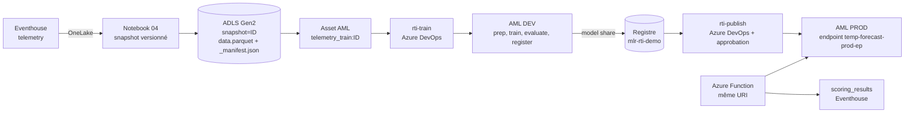
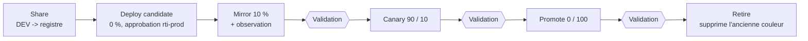

# Guide MLOps - composants et mode d'emploi

Ce guide s'adresse à l'équipe qui reprend ce dépôt. Il décrit la chaîne MLOps **DEV -> PROD** (piste C), ses
composants, et comment la rejouer ou l'adapter. Il ne décrit pas la qualité du modèle : le modèle
(`temp_forecaster`, régression sklearn) et les données (télémétrie simulée) sont volontairement simples, pour que
l'attention reste sur la chaîne.

Documents associés : [MLOPS-BRIEF.md](MLOPS-BRIEF.md) (le pourquoi), [MLOPS-PLAN.md](MLOPS-PLAN.md) (les étapes
M0 à M8), [MLOPS-ADO-SETUP.md](MLOPS-ADO-SETUP.md) (mise en place Azure DevOps), [RUNBOOK.md](RUNBOOK.md)
(démarrer / arrêter la démo), [PROGRESS.md](PROGRESS.md) (journal de tout ce qui a été fait, y compris les échecs).

## 1. Les trois garde-fous

| Garde-fou | Problème évité | Où c'est implémenté |
|---|---|---|
| **Données figées** | un entraînement sur des données qui changent, donc non reproductible | notebook `04`, `_manifest.json`, asset de données versionné, vérification dans `prep` |
| **Registre partagé** | copier un modèle à la main d'un espace de travail à l'autre, sans trace | registre AML `mlr-rti-demo`, `az ml model share` |
| **Déploiement progressif** | passer 100 % du trafic sur un nouveau modèle d'un coup | pipeline `rti-publish` : 0 % -> mirror -> canary -> 100 % -> retrait |

Le fil qui relie les trois est la **traçabilité** : pour un modèle en production, on remonte à son job
d'entraînement, aux données exactes (empreinte SHA-256), au commit Git et au run Azure DevOps.

## 2. Vue d'ensemble



Deux espaces de travail AML (DEV `aml-rti-demo`, PROD `aml-rti-prod`) et un registre `mlr-rti-demo` qui sert de
point de passage. PROD n'a pas de cluster de calcul : il ne fait que servir le modèle.

## 3. Les composants

### 3.1 Données figées

| Élément | Fichier / ressource | Rôle |
|---|---|---|
| Notebook de snapshot | [fabric/notebooks/04_snapshot_versioned.ipynb](../fabric/notebooks/04_snapshot_versioned.ipynb) | lit la table `telemetry`, calcule les variables (retards, fenêtres glissantes), écrit un dossier de snapshot |
| Dossier de snapshot | `ml/training/site=<site>/snapshot=<YYYYMMDD-HHMM>/` dans ADLS | `data.parquet` puis `_manifest.json` |
| Manifeste | `_manifest.json` | empreinte SHA-256 des données, nombre de lignes, bornes de la fenêtre, version Delta source. **Écrit en dernier** : sa présence signifie que le snapshot est complet |
| Asset de données | [scripts/72_register_snapshot_asset.py](../scripts/72_register_snapshot_asset.py) | enregistre `telemetry_train:<id>` avec 7 tags obligatoires, sans jamais écraser une version existante |

Règle : un snapshot ne s'écrase jamais. Relancer le notebook avec le même identifiant détecte le snapshot existant
et s'arrête sans rien modifier. Pour de nouvelles données, on crée un **nouveau** snapshot.

Note : le notebook Fabric n'a pas accès au dépôt. Son code est donc recopié dans le notebook, ce qui est assumé.
Les identifiants (workspace, base KQL, compte de stockage) sont en tête de notebook.

### 3.2 Entraînement (AML DEV)

Pipeline AML : [aml/pipelines/training_pipeline.yml](../aml/pipelines/training_pipeline.yml), quatre composants
dans [aml/components](../aml/components) :

| Composant | Rôle |
|---|---|
| `prep` | **vérifie** le snapshot avant tout calcul (hash du manifeste, hash du parquet, fichiers parasites, nombre de lignes, colonnes, bornes de la fenêtre). Échoue en nommant l'écart. Sépare train / test avec une marge temporelle |
| `train` | entraîne la régression (format MLflow) |
| `evaluate` | calcule MAE / RMSE sur la période de test et applique la **gate** : si la MAE dépasse `max_mae`, le pipeline s'arrête |
| `register` | enregistre le modèle `temp_forecaster` avec ses métriques et sa traçabilité en tags |

Étiquettes portées par le modèle : `git_sha`, `ado_build_id`, `data_asset`, `data_manifest_sha256`, `mae`, `rmse`,
`baseline_mae`, `skill_vs_baseline`, `test_period_end`.

Le script [scripts/20_aml_train.ps1](../scripts/20_aml_train.ps1) soumet ce pipeline. Il refuse de partir si
l'asset de données est absent ou sans empreinte de manifeste valide. Sans arguments de traçabilité, il se comporte
comme en piste A (usage manuel).

### 3.3 Registre partagé

Création : [scripts/75_mlops_registry.ps1](../scripts/75_mlops_registry.ps1) (définition dans
[aml/registry/registry.yml](../aml/registry/registry.yml)). Droits : [scripts/71_mlops_rbac.ps1](../scripts/71_mlops_rbac.ps1)
(DEV écrit, PROD lit). Le passage DEV -> registre se fait avec `az ml model share`, **même nom, même numéro de
version** de chaque côté. Les tags du modèle sont conservés.

Le registre a un coût permanent (son stockage et son ACR) : voir la section 7.

### 3.4 Pipelines Azure DevOps

Fichiers dans [devops/pipelines](../devops/pipelines), gabarits dans [devops/templates](../devops/templates).
Aucun secret : deux connexions de service par **fédération d'identité**, avec des droits séparés.

| Pipeline | Fichier | Déclenchement | Ce qu'il fait |
|---|---|---|---|
| `rti-train` | `train.yml` | manuel, paramètre `snapshotId` | enregistre l'asset du snapshot si besoin, soumet l'entraînement dans DEV, attend la fin, publie `model-info` (version du modèle et traçabilité) |
| `rti-publish` | `publish.yml` | manuel, paramètre `modelVersion` | voir 3.5 |
| `rti-auth-test` | `auth-test.yml` | manuel | contrôle d'identité des connexions de service |

| Connexion de service | Droits |
|---|---|
| `sc-rti-aml-dev` | écrit dans DEV et dans le registre, lit le stockage des snapshots |
| `sc-rti-aml-prod` | lit le registre, écrit uniquement dans PROD |

Les pipelines appellent des **scripts du dépôt** (`scripts/*.ps1`) : le même code tourne dans la CI et sur un poste.
Les runs s'exécutent sur un agent auto-hébergé (pool `rti-mlops-local`) : l'agent doit être en ligne.

### 3.5 Publication progressive (`rti-publish`)



La logique est dans [scripts/80_prod_rollout.ps1](../scripts/80_prod_rollout.ps1) (un paramètre `-Stage` par étape).
Les changements de trafic passent tous par [scripts/41_aml_traffic.ps1](../scripts/41_aml_traffic.ps1).

Points de conception :

- Le endpoint a deux déploiements, **blue** et **green**. La couleur candidate est **calculée** : c'est l'autre
  que celle qui sert 100 %. Deux publications successives alternent donc sans modifier le YAML.
- État de départ exigé : une couleur à 100 %, mirror vide. Sinon le stage s'arrête et indique quoi faire.
- Le **mirror** copie une part des appels vers le candidat et jette ses réponses : il le chauffe et prouve qu'il ne
  plante pas, sans exposer personne. Le **canary** route réellement une part des appels. Une couleur reçoit du
  trafic réel **ou** du mirror, jamais les deux.
- Rien n'est créé en PROD sans approbation humaine (environnement Azure DevOps `rti-prod`). Trois validations
  manuelles rythment la suite.
- L'ancienne couleur n'est supprimée qu'à 0 % de trafic, après validation. Avant cette suppression, le
  `rollback` (paramètre `action`) revient à la couleur précédente sans rien détruire.
- Chaque étape relit l'état réel du endpoint plutôt que de se fier aux codes retour.
- La Function ne change jamais d'URI : elle appelle toujours `temp-forecast-prod-ep`, et lit l'en-tête
  `azureml-model-deployment` pour journaliser la couleur qui a répondu.

### 3.6 Création et destruction du endpoint PROD

| Script | Rôle |
|---|---|
| [scripts/81_prod_endpoint_bootstrap.ps1](../scripts/81_prod_endpoint_bootstrap.ps1) | crée le endpoint PROD avec la **dernière version du registre** (ou `-ModelVersion <n>`), sur la couleur blue à 100 %. À lancer une fois, avant une démo. Demande une confirmation |
| [scripts/70_mlops_prod_bootstrap.ps1](../scripts/70_mlops_prod_bootstrap.ps1) | crée l'espace de travail PROD |
| [scripts/73_function_target.ps1](../scripts/73_function_target.ps1) | oriente la Function vers `dev` ou `prod`, avec confirmation et vérification dans `scoring_results` |

Un endpoint managé est **facturé en continu**, et il y a deux instances pendant une publication. Pour supprimer :
`.\scripts\90_teardown.ps1` (confirmation avant chaque suppression ; supprime le **endpoint**, pas un déploiement seul,
et en option le registre et l'espace PROD).

## 4. Déroulé complet d'un cycle

1. **Figer les données.** Exécuter le notebook `04` (identifiant vide = horodatage courant). Noter l'identifiant,
   par exemple `20261014-1315`.
2. **Entraîner.** Lancer `rti-train` avec `snapshotId` = cet identifiant (la valeur seule). Paramètre `maxMae` :
   5.0 par défaut ; `0.1` fait échouer la gate à dessein, pour la démontrer.
   Résultat : un job AML `Completed`, une nouvelle version de `temp_forecaster`, l'artefact `model-info`.
3. **Publier.** Lancer `rti-publish` avec `modelVersion` = la version obtenue, `action` = `promote`.
   Approuver le déploiement, puis valider chaque point d'arrêt après avoir regardé `scoring_results` :

   ```kusto
   scoring_results | where scored_at > ago(10m) | summarize count() by deployment, model_version
   ```
4. **Revenir en arrière si besoin.** `rti-publish` avec `action` = `rollback` tant que l'ancienne couleur existe.
5. **Prouver la traçabilité.** Depuis le modèle servi : tags du modèle -> job AML -> asset de données ->
   `manifest_sha256` -> commit Git -> run Azure DevOps.

Pour la **première** publication, il faut d'abord un endpoint avec un modèle en production : lancer
`81_prod_endpoint_bootstrap.ps1`. Ensuite, la version publiée doit être **plus récente** que celle servie, donc un
nouveau `rti-train` est nécessaire avant chaque `rti-publish`.

## 5. Mise en place dans un autre environnement

Voir **[QUICKSTART.md](QUICKSTART.md)** : prérequis, remplissage de `demo.config.env` (le seul fichier de
paramètres), déroulé manuel pas à pas et déroulé assisté par l'agent `RTI-AML-Agent`.

Rien n'est généré par IaC : la création des ressources est faite par des scripts `az` dans [scripts](../scripts)
(volontairement, pour un chemin court en démonstration). Les noms (abonnement, groupe de ressources, espaces de travail,
registre, comptes de stockage, Function, Fabric, Azure DevOps) sont lus dans `demo.config.env` par les scripts, les
notebooks (à la publication) et les pipelines. Seules quelques conventions restent figées dans des YAML : elles sont
listées en bas de ce fichier.

Le nom d'un registre doit être unique dans le tenant. La version de l'extension `ml` est épinglée dans
[devops/templates/setup-azml.yml](../devops/templates/setup-azml.yml) : la garder identique à celle utilisée en local.

## 6. Pour utiliser ses propres données et son propre modèle

La chaîne est indépendante du modèle. Pour la réutiliser :

- **Données** : remplacer la lecture de la table et le calcul des variables dans le notebook `04`, en conservant le
  contrat du snapshot (`data.parquet`, puis `_manifest.json` écrit en dernier, même liste de clés) et les 7 tags de
  l'asset (`site`, `window_start`, `window_end`, `row_count`, `manifest_sha256`, `source_table`,
  `source_delta_version`). `prep.py` valide ce contrat.
- **Modèle** : modifier `train.py` et `evaluate.py` (métrique et seuil de la gate). Le modèle doit rester enregistré
  au format MLflow, sinon le déploiement sans code de scoring ne fonctionne plus.
- **Scoring** : si le format d'entrée change, adapter la Function (`functions/function_app.py`).

## 7. Coûts, nettoyage et limites connues

Coûts à surveiller :

- le endpoint managé PROD, facturé 24 h / 24 (deux instances pendant une publication) : le créer la veille, le
  supprimer après ;
- le registre : coût permanent (stockage + ACR Premium) ;
- la capacité Fabric : la mettre en pause hors démonstration ;
- le script `scripts/91_cost_guard.ps1` liste ce qui facture encore.

Limites assumées de cette démonstration :

- pas d'IaC, pas de GitHub Actions, pas de pipelines de déploiement Fabric ;
- réseau public (pas de VNet ni de réseau privé) ;
- pas de supervision de modèle (dérive), pas de multi-site, pas de champion / challenger, pas de endpoint batch ;
- un seul modèle, une seule version servie à 100 %, un endpoint par environnement ;
- un agent Azure DevOps auto-hébergé sur un poste : pour un usage durable, prévoir un agent dédié.

Enseignements de la mise au point (détail dans [PROGRESS.md](PROGRESS.md)) : un code retour 0 d'une commande `az ml`
ne prouve pas que l'état a changé (c'est pourquoi les scripts relisent le endpoint) ; chaque étape du déploiement
progressif a dû être rejouée réellement pour être considérée comme éprouvée.
