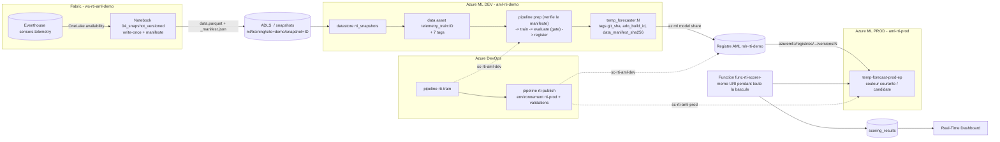

# Plan d'implémentation — Piste C : MLOps DEV → PROD piloté par Azure DevOps

> **Source de la demande** : [MLOPS-BRIEF.md](MLOPS-BRIEF.md) (atelier MLOps #2 — le client, 7 oct. 2026).
> **Statut** : M0 rédigé, **en attente de validation par the owner**. Aucune écriture Azure n'a été faite.
> **Journal** : [PROGRESS.md](PROGRESS.md), IDs d'étape `M0…M8` (disjoints des `P0…P8` de la piste A).

**Pitch (30 s)** : la piste A s'arrête à « le modèle v2 remplace le v1 sur un endpoint ». La piste C
montre **comment on y arrive en vrai** : la donnée d'entraînement est figée et versionnée, Azure DevOps
déclenche l'entraînement dans un workspace **DEV**, le modèle est promu vers un workspace **PROD** par
un **registre Azure ML partagé**, et l'endpoint bascule **progressivement**. L'Azure Function qui score
en continu ne voit rien passer : même URI, zéro interruption.

---

## 1. Les trois garde-fous — le message de la démo

le client a déjà le flux. On ne le remplace pas, on y ajoute trois choses qui leur manquent :

| Leur pratique actuelle | Ce qu'on montre | Pourquoi ça compte |
|---|---|---|
| Dataset qui bouge | **Donnée figée** : snapshot write-once + manifeste vérifié par le pipeline | Un run non reproductible n'est pas auditable |
| « copy model » DEV → PROD | **Registre AML partagé**, même nom et même version des deux côtés | La copie casse le lien vers le job d'entraînement |
| L'endpoint prend 100 % du trafic à chaque déploiement | **Bascule progressive** : 0 % → miroir → canari → 100 % → retrait | Un modèle cassé ne doit jamais voir 100 % du trafic |

Le quatrième fil, transversal : **data ↔ code ↔ modèle sont reliés** par des tags
(`git_sha`, `ado_build_id`, `manifest_sha256`), et `78_trace_lineage.ps1` remonte la chaîne complète
depuis l'endpoint PROD jusqu'au commit.

---

## 2. Architecture cible



---

## 3. Ce qu'on réutilise (et ce qu'on ne touche pas)

**Principe** : la piste C est un **sur-ensemble** de la piste A. Tout ajout au pipeline AML, aux
scripts d'endpoint et à la Function est **optionnel et rétro-compatible** — critère AT-13.

| Brique existante | Réutilisation en piste C | Modification |
|---|---|---|
| Eventhouse `sensors.telemetry` + OneLake availability | source du snapshot (acte 1) et de la boucle live (acte 6) | aucune |
| `fabric/notebooks/01_snapshot_to_datastore.ipynb` | **modèle** du nouveau `04_snapshot_versioned.ipynb` | aucune — `01` reste intact |
| Datastore `rti_snapshots` (ADLS, identité) | datastore par défaut de la piste C | aucune |
| `aml/pipelines/training_pipeline.yml` + composants | pipeline d'entraînement DEV | **+3 entrées optionnelles** (`git_sha`, `ado_build_id`, `expected_manifest_sha256`) |
| `aml/components/prep.py` | vérification du manifeste | **+1 paramètre optionnel**, comportement inchangé s'il est absent |
| `aml/components/register.py` | tags de traçabilité | **+3 tags** |
| `scripts/20_aml_train.ps1` | soumission du pipeline, en local **et** depuis ADO | **+3 paramètres** avec valeurs par défaut |
| `scripts/30_aml_endpoint.ps1` | création de la couleur candidate | **+`-ModelUri`** (référence de registre) ; `-SkipTraffic` déjà présent |
| `scripts/41_aml_traffic.ps1` | **toutes** les bascules de trafic | **+`-MirrorTarget blue\|green`** |
| `functions/function_app.py` | boucle de scoring | **TTL de cache paramétrable** + regex validée sur une URI de registre |
| Dashboard RTI (tuiles par `deployment`) | preuve visuelle de l'acte 6 | filtrage sur une fenêtre récente |
| `scripts/91_cost_guard.ps1` | garde-fou de coût | **+endpoint PROD + registre** |
| `scripts/66_job_diag.py` | descente dans les logs du job enfant | aucune |

**Interdits** : casser la piste A, toucher `01_snapshot_to_datastore.ipynb`, utiliser `--all-traffic`
ailleurs que dans le bootstrap PROD, supprimer une couleur sans validation explicite.

---

## 4. Nommage

| Élément | Nom | État |
|---|---|---|
| Workspace AML **DEV** | `aml-rti-demo` | existant |
| Workspace AML **PROD** | `aml-rti-prod` (RG `rg-rti-aml-demo`, `westus3`, sans cluster) | à créer (M1) |
| Registre AML | `mlr-rti-demo` (`westus3`) | à créer (M1) |
| Endpoint PROD | `temp-forecast-prod-ep` — couleurs `blue` / `green` | à créer (M6) |
| Data asset | `telemetry_train:<snapshot_id>` (`uri_folder`) | à créer (M2) |
| Chemin snapshot | `ml/training/site=demo/snapshot=<YYYYMMDD-HHMM>/` | à créer (M2) |
| Modèle | `temp_forecaster` — **même nom et même version** en DEV et dans le registre | existant |
| Connexions de service ADO | `sc-rti-aml-dev`, `sc-rti-aml-prod` (fédération d'identité) | à créer (M4) |
| Environnement ADO | `rti-prod` (avec approbation) | à créer (M4) |
| Pipelines ADO | `rti-train`, `rti-publish` | à créer (M5, M6) |

---

## 5. Décisions — **validées le 2026-10-07**

Reprises de la §7 du brief, puis **amendées** par l'entretien du 2026-10-07 (§7 ci-dessous).
the owner a validé l'ensemble tel qu'amendé. **M1 est débloqué.**

| # | Décision | Motif | État |
|---|---|---|---|
| D1 | Piste C séparée, étapes `M0…M8`, ce fichier comme plan, même journal | Les IDs d'étape ne se mélangent pas ; la piste A reste rejouable telle quelle | ✅ validée |
| D2 | DEV = `aml-rti-demo` ; PROD = **nouveau** `aml-rti-prod` dans le **même RG** (exemption de policy), sans cluster | Réutilise données, compute et historique ; l'exemption `exempt-rti-aml-demo` couvre le stockage du nouveau workspace | ✅ validée |
| D3 | Registre `mlr-rti-demo`, modèle promu **sans changement de nom ni de version** | Remplace la « copy model » ; conserve le lien vers le job DEV | ⚠️ validée **sous condition** — voir D3-bis |
| D4 | Endpoint PROD en identité **système**, `aad_token`, `Standard_DS2_v2` × 1 | Configuration déjà éprouvée en piste A ; une UAMI exigerait AcrPull + Storage Blob Data Reader au niveau souscription pour lire le registre | ✅ validée |
| D5 | Données via `rti_snapshots` (ADLS, GA) **par défaut** ; variante OneLake **en vitrine, hors CI** | La CI doit tourner capacité Fabric en pause (~138 $/jour évités) | ✅ validée |
| D6 | 2 connexions de service en **fédération d'identité**, zéro secret ; environnement `rti-prod` avec approbation | Séparation DEV/PROD lisible ; respecte la règle « jamais de secret » | ⚠️ validée **amendée** — org + projet **à créer**, impérativement sur le tenant `<TENANT_ID>` |
| D7 | Les pipelines ADO appellent **les scripts du repo** via `AzureCLI@2` | Même code en local et en CI ; rejouable sans ADO | ⚠️ validée **amendée** — **agent auto-hébergé**, voir D7-bis |
| D8 | Le bootstrap PROD (endpoint + 1re couleur) est un script **lancé une fois par the owner**, hors CI | Le seul `--all-traffic` légitime reste hors CI | ✅ validée |

### Amendements

**Correction 2026-10-12 — separate Azure DevOps and Azure accounts/tenants are supported.**
the owner uses his Microsoft corporate account for Azure DevOps and his demo-tenant administrator
for Azure resources. Keep the Azure DevOps organization in its existing tenant; do not migrate it.
Earlier statements in this document requiring the same tenant or declaring federation impossible
are incorrect and superseded by this correction. Configure the ARM service connections manually
with workload identity federation to an app registration or user-assigned managed identity in the
target Azure tenant. Copy the exact issuer and subject generated by Azure DevOps into the target
identity's federated credential, grant scoped Azure RBAC, then verify and save the connection.
No client secret is required. Corporate organization restrictions and target permissions still need verification.
Reference: https://learn.microsoft.com/en-us/azure/devops/pipelines/release/configure-workload-identity?view=azure-devops

**Blocker 2026-10-12 — subscription Disabled.** Azure MCP subscription discovery confirmed
`<SUBSCRIPTION_ID>` is `Disabled`; the portal rejects policy exemption creation
because the subscription is read-only. This is not evidence of insufficient RBAC permissions.
Suspend Azure writes for M1 and M6, including the traced-copy fallback, until subscription reactivation
is confirmed. Repository preparation and independent Azure DevOps setup can continue. If reactivation
is unavailable, using another active subscription requires new discovery, user approval and replanning
of resources and identities; it is not a simple registry fallback. The cause of disablement is unknown.

**Update 2026-10-12 — no external administrator dependency.** the owner requires using his own
effective permissions or adapting the plan. The administrator request below is historical, not
a prerequisite anymore. First verify effective permission for `Microsoft.Authorization/policyExemptions/write`
at the exemption scope and `Microsoft.Authorization/policyAssignments/exempt/action` on the governing
assignment. An empty role-assignment list is not proof of missing effective permissions.
If authorized, create only the necessary temporary exemption using the owner's identity; otherwise
use the existing traced-copy fallback (DEV model download, PROD registration with lineage tags).
Do not elevate privileges, change the governing policy, or claim that the fallback demonstrates a shared registry.

**D3-bis — le registre est conditionné à une exemption de policy à portée souscription.**
Un registre AML crée **son propre stockage et son propre ACR dans un groupe de ressources managé**
(`azureml-rg-mlr-rti-demo-…`) que l'on ne choisit pas. Or les deux seules exemptions de la
souscription (`exempt-rti-aml-demo`, `exempt-storage-public-network`) sont **à portée groupe de
ressources** — vérifié par Resource Graph le 2026-10-07. La policy `MCAPSGovDeployPolicies`, assignée
au **management group** en **remédiation continue**, remettra donc `publicNetworkAccess: Disabled`
sur le stockage du registre.

> ⚠️ **C'est un échec à retardement** : la création du registre peut réussir, la remédiation ne
> frappant que quelques minutes plus tard. On ne s'en apercevrait qu'au premier `az ml model share`.
> D'où le critère de sortie renforcé de M1 : partager `temp_forecaster:6` **en test**, puis
> **revérifier `publicNetworkAccess` sur le stockage du registre après 30 min**.

the owner demande l'exemption à l'admin de souscription (`<subscription-admin>`,
celui qui avait créé `exempt-rti-aml-demo`). Commande à transmettre :

```bash
az policy exemption create \
  --name exempt-rti-aml-registry \
  --scope "/subscriptions/<SUBSCRIPTION_ID>" \
  --policy-assignment "/providers/Microsoft.Management/managementGroups/<TENANT_ID>/providers/Microsoft.Authorization/policyAssignments/MCAPSGovDeployPolicies" \
  --exemption-category Waiver \
  --description "Demo MLOps RTI x AML - stockage et ACR manages du registre mlr-rti-demo" \
  --expires-on 2026-11-30
```

**Date de non-retour : 2026-10-14.** Sans exemption à cette date, bascule sur le **plan B** (copie
tracée : `model download` en DEV + `model create` en PROD avec des tags pointant sur le job DEV).
Le plan B fonctionne, mais c'est précisément le statu quo du client — l'acte 3 perd son argument.
**À supprimer au teardown, comme `exempt-rti-aml-demo`.**

**D7-bis — agent auto-hébergé.** Une organisation Azure DevOps neuve démarre à **0 job parallèle
hébergé** ; l'octroi gratuit demande 2 à 3 jours ouvrés, incompatible avec le 21/10. Conséquences
sur le plan :

- les pipelines déclarent `pool: name: <pool-local>` et **non** `vmImage` ;
- `devops/templates/setup-azml.yml` devient une **vérification** de la version de l'extension `ml`
  et du compte `az` connecté, plutôt qu'une installation — `az` et `ml` sont déjà éprouvés sur le poste ;
- un script `scripts/74_ado_agent.ps1` installe et enregistre l'agent (ajouté à M4) ;
- contrainte d'exploitation : **le poste doit être allumé pendant l'atelier**. À écrire noir sur
  blanc dans la préparation J-1 du script de démo.

---

## 5-bis. Contraintes issues de l'entretien du 2026-10-07

| Sujet | Décision | Conséquence sur le plan |
|---|---|---|
| `temp-forecast-ep` (DEV) | **supprimé le 2026-10-07** | ≈ 3,50 $/j économisés ; à recréer à J-1 si l'acte 1 le réclame |
| Cible de la Function en fin de démo | **PROD seule** | `73_function_target.ps1 -Target prod` ; un seul endpoint à vide entre deux sessions |
| Coût pendant la bascule | 2 déploiements en parallèle sur l'endpoint PROD | ≈ 7 $/j **le temps du rollout seulement** |
| Variante OneLake (R-14) | **retenue en vitrine**, hors chemin critique | montrée à l'écran ; la CI reste sur `rti_snapshots` (ADLS) |
| Date de l'atelier | **2026-10-21** | répétition **19/10**, endpoint PROD **20/10**, non-retour D3 **14/10** |

---

## 6. Phases

Légende : ⬜ à faire · 🟡 en cours · ✅ fait · ❌ bloqué

### M0 — Cadrage ✅ **(aucune écriture Azure, hors la suppression d'économie ci-dessous)**
- [x] Lire [MLOPS-BRIEF.md](MLOPS-BRIEF.md), [DEMO-PLAN.md](DEMO-PLAN.md), [PROGRESS.md](PROGRESS.md), [RUNBOOK.md](RUNBOOK.md).
- [x] Réécrire les instructions de l'agent : piste B retirée, piste C ajoutée.
- [x] Écrire ce plan + entrée de journal.
- [x] Retirer du dépôt les artefacts de la piste B (fine-tuning), portés sur un autre dépôt.
- [x] **Inventaire des endpoints existants et de leur coût en cours** (R-03, Resource Graph) : un seul online endpoint dans `rg-rti-aml-demo` — `temp-forecast-ep`, `blue=100`, qui facturait 24/7. **Aucun endpoint de la piste B** ⇒ pas de dépense cachée de ce côté. Inventaire détaillé piste B : script retiré du dépôt avec la piste B (voir `docs/PROGRESS.md`).
- [x] **Supprimer `temp-forecast-ep`** (décision de the owner) — vérifié par Resource Graph, problème #13 clos.
- [x] **Vérifier les droits RBAC et les exemptions de policy** : RBAC acquis, aucune exemption à portée souscription → D3-bis.
- [x] **Répondre aux 8 questions** du §7 — toutes closes.
- [x] **Validation de the owner sur D1–D8** (tels qu'amendés) → **M1 débloqué**.
- [ ] *(reporté en M1, non bloquant)* Compléter l'inventaire : workspaces, modèles, data assets, policies applicables **hors** `rg-rti-aml-demo` (reste de R-03).

### M1 — Workspace PROD, registre, droits ⬜ — R-01 à R-03

**Découpé en deux**, parce que seule la seconde moitié dépend de l'admin. Bloquer M1 entier sur
l'exemption ferait perdre une semaine pour rien.

**M1a — workspace PROD** (aucune dépendance externe, faisable immédiatement)
- [ ] `scripts/70_mlops_prod_bootstrap.ps1` partie 1 : crée `aml-rti-prod`
      (`--system-datastores-auth-mode identity`, **sans cluster**). Idempotent, ASCII.
- [ ] Le workspace naît dans `rg-rti-aml-demo` ⇒ **couvert par `exempt-rti-aml-demo`**, sans risque de policy.
- [ ] **Critère de sortie** : workspace `Succeeded` vu par Resource Graph, et son storage en `publicNetworkAccess: Enabled` **30 min après** création.

**M1b — registre + droits** (⛔ **dépend de l'exemption `exempt-rti-aml-registry`**)
- [ ] **Chemin critique, à lancer en premier** : demander à l'admin l'exemption (commande en §5, D3-bis). **Non-retour le 14/10.**
- [ ] `aml/registry/registry.yml` (`location: westus3`, `replication_locations: [westus3]`).
- [ ] `scripts/70_mlops_prod_bootstrap.ps1` partie 2 : crée le registre `mlr-rti-demo`.
- [ ] `scripts/71_mlops_rbac.ps1` : rôles DEV / PROD / registre + MI de la Function sur l'endpoint PROD.
- [ ] Vérifier **par Resource Graph**, pas par la sortie du script.
- [ ] **Critère de sortie** : `temp_forecaster:6` partagé en test et visible dans le registre avec son lien vers le job DEV, **et** `publicNetworkAccess` du stockage **managé du registre** toujours `Enabled` **30 min après** sa création (sinon → plan B §9).

### M2 — Données versionnées ⬜ — R-10 à R-13 (R-14, R-15 optionnels)
- [ ] `fabric/notebooks/04_snapshot_versioned.ipynb` : paramètres `SNAPSHOT_ID` / `SITE` / `TARGET`, lecture Delta à version figée, **même feature engineering que `01`**, refus si le dossier existe, `data.parquet` **puis** `_manifest.json`.
- [ ] `scripts/72_register_snapshot_asset.py --snapshot-id <id>` : lit le manifeste, calcule son SHA-256, enregistre `telemetry_train:<id>` avec les **7 tags**, sort en succès si la version existe déjà.
- [ ] `prep.py` / `prep.yml` : `--expected_manifest_sha256` **optionnel** (`$[[...]]`), échec explicite **avant** l'entraînement.
- [ ] (SHOULD) variante OneLake : lakehouse `lh_rti_ml` + datastore `onelake_rti_ml` créé **par SDK**.
- [ ] **Critères de sortie** : AT-01, AT-02, AT-03.

### M3 — Traçabilité dans le pipeline AML ⬜ — R-20, R-21
- [ ] `training_pipeline.yml` : entrées optionnelles `git_sha`, `ado_build_id` (défaut `local`), `expected_manifest_sha256`.
- [ ] Tags de job à la soumission : `git_sha`, `ado_build_id`, `data_asset`, `snapshot_id`.
- [ ] `register.py` : `git_sha`, `ado_build_id`, `data_manifest_sha256` en plus des tags existants. **Enregistrement octet pour octet** (leçon P5 : jamais recharger puis re-logger).
- [ ] **Critères de sortie** : un run local porte les nouveaux tags + **AT-13** (non-régression piste A).

### M4 — Socle Azure DevOps ⬜ — R-30 à R-32
- [ ] **Créer l'organisation et le projet** sur le tenant `<TENANT_ID>`. Vérifier le tenant **avant** de créer les connexions de service : la fédération d'identité ne franchit pas les tenants.
- [ ] `git init` + premier push vers Azure Repos (le dossier n'est **pas** encore un dépôt Git — §9).
- [ ] `scripts/74_ado_agent.ps1` : installe et enregistre l'**agent auto-hébergé** dans un pool dédié, vérifie que `az` et l'extension `ml` répondent depuis le contexte de l'agent.
- [ ] `docs/MLOPS-ADO-SETUP.md` : projet, repo, 2 connexions de service en fédération d'identité, environnement `rti-prod` avec approbation, groupe de variables `rti-mlops` (**aucun secret**), pool de l'agent, création des pipelines depuis le YAML.
- [ ] `devops/templates/setup-azml.yml` : **vérifie** la version de l'extension `ml` (et l'installe si absente), `az account show` et le workspace cible.
- [ ] **Critère de sortie** : un run « hello » par connexion affiche le bon compte et le bon workspace, **sur l'agent local**.

### M5 — Pipeline `rti-train` ⬜ — R-40 à R-42
- [ ] `devops/pipelines/train.yml` : **déclenchement manuel** (planification trimestrielle laissée en commentaire), paramètres `snapshotId` (**obligatoire**) et `maxMae` (5.0).
- [ ] Étapes : garantir le data asset → soumettre le pipeline AML avec `git_sha`/`ado_build_id`/empreinte → **polling** de `az ml job show --query status` → retrouver la version par le tag `ado_build_id` → publier `model-info.json` + un résumé de run.
- [ ] Gate KO ⇒ aucun enregistrement, run en échec avec le message du composant. **Conserver l'URL d'un run rejeté** — l'acte 4 le montre en différé (§10.1).
- [ ] **Critères de sortie** : AT-04, AT-05.

### M6 — Bootstrap PROD, bascule de la Function, `rti-publish` ⬜ — R-50 à R-54, R-60 à R-63
- [ ] `30_aml_endpoint.ps1` : `-ModelUri` (référence de registre) sans casser `-ModelVersion` ; ne pas reporter en PROD le tag `data_asset` codé en dur de `deployment-blue.yml`.
- [ ] `41_aml_traffic.ps1` : `-MirrorTarget blue|green` (défaut `green`).
- [ ] `70_mlops_prod_bootstrap.ps1` (2e partie) : endpoint PROD + 1re couleur — **seul `--all-traffic` autorisé**.
- [ ] `scripts/73_function_target.ps1 -Target dev|prod` : met à jour `AML_SCORING_URI` / `AML_WORKSPACE` / `AML_ENDPOINT_NAME`, **demande confirmation**, vérifie dans `scoring_results`.
- [ ] `function_app.py` : `DEPLOYMENT_CACHE_TTL_SEC` en paramètre d'application (600 par défaut, **60** en piste C) + test unitaire de la regex sur une URI `azureml://registries/...`.
- [ ] `devops/pipelines/publish.yml` : `modelVersion`, `action` (`promote`/`rollback`), `mirrorPercent`, `canaryPercent`, `observeMinutes` ; **état de départ exigé = une couleur à 100 %, miroir vide** ; couleur candidate **calculée** ; étapes `share` → `deploy_candidate` → `mirror` → `canary` → `promote` → `retire`, chacune idempotente, les 3 dernières derrière une validation manuelle.
- [ ] **Approbation sur `deploy_candidate`** (environnement `rti-prod`, cf. R-51) : rien n'est créé dans la PROD — **pas même à 0 % de trafic** — sans accord humain. Les validations manuelles de `mirror` / `canary` / `retire` restent des **points de rythme** pour le présentateur.
- [ ] *(R-54, SHOULD)* `rti-publish` peut être déclenché par la fin d'un run `rti-train` (ressource de pipeline), en lisant `model-info.json`. **Le déclenchement manuel reste possible** et reste le mode utilisé en démo.
- [ ] **Critères de sortie** : AT-06 à AT-09, AT-14.

### M7 — Démo ⬜ — R-22, R-71, R-72
- [ ] `scripts/78_trace_lineage.ps1` : endpoint → modèle du registre → job DEV → data asset → `manifest_sha256` → commit → run ADO.
- [ ] `docs/MLOPS-DEMO-SCRIPT.md` : 6 actes (4/4/3/6/4/4 min), ce que je montre / ce que je dis / commandes / résultat attendu / plan B, + préparation J-7, J-2, J-1, H-1.
- [ ] `docs/RUNBOOK.md` : section « Piste C » (démarrage, arrêt, ordre des vérifications). **La séquence de la piste A n'est pas modifiée.**
- [ ] **Critères de sortie** : AT-10, AT-12.

### M8 — Coûts et teardown ⬜ — R-73
- [x] `scripts/90_teardown.ps1` : confirmation avant chaque suppression, supprime l'**endpoint** (jamais le déploiement d'abord), registre et workspace PROD en option.
- [ ] `91_cost_guard.ps1` étendu à l'endpoint PROD et au registre.
- [ ] **Critère de sortie** : AT-11.

**Chemin critique** : M1 → M4 → M5 → M6. M2 et M3 avancent en parallèle de M4.
Repli : si M2 n'est pas prêt, M5 démarre sur `telemetry_features:1` (sans manifeste) puis bascule.

---

## 6-bis. Plan d'exécution — calendrier jusqu'au 21/10

Le 2026-10-07 est un **mercredi**. Il reste **8 jours ouvrés de construction** (08 → 16/10), puis
répétition le lundi 19, mise en place le mardi 20, atelier le mercredi 21.

### Ce qui conditionne tout : trois actions de the owner, aujourd'hui

Ces trois-là ont une **latence externe** ou bloquent une chaîne entière. Tout le reste en dépend.

| # | Action | Durée | Pourquoi aujourd'hui |
|---|---|---|---|
| 1 | Envoyer à l'admin la demande d'exemption `exempt-rti-aml-registry` (commande prête en §5, D3-bis) | 3 min | **Le plus long délai du projet est hors de notre contrôle.** Non-retour le 14/10 |
| 2 | Créer l'organisation **et** le projet Azure DevOps **sur le tenant `<TENANT_ID>`** | 15 min | Un mauvais tenant rend la fédération d'identité impossible et oblige à **tout recréer** |
| 3 | `git init` + `.gitignore` + premier commit | 10 min | Ce dossier n'est **pas** un dépôt Git. Sans lui : pas de `git_sha`, pas de clone ADO, pas de M3 ni de M4 |

### Qui fait quoi

| Acteur | Rôle |
|---|---|
| **Moi** | j'écris tous les artefacts **dans le dépôt** : notebooks, composants, YAML de pipelines, scripts `.ps1`/`.py`, documentation |
| **the owner** | il **exécute** les scripts et les commandes `az` (le terminal intégré est instable, problème #3), fait les clics portail non couverts par MCP, et me colle les sorties |
| **Vérification** | toujours par une **source indépendante** — Resource Graph, relecture de l'endpoint, requête KQL. Jamais la sortie du script seule |

### Calendrier

| Jour | Chemin critique | En parallèle | Sortie attendue |
|---|---|---|---|
| **Mer 07/10** *(reste de journée)* | les 3 actions ci-dessus | — | demande d'exemption **partie**, org ADO créée sur le bon tenant, dépôt Git initialisé |
| **Jeu 08/10** | **M1a** workspace `aml-rti-prod` · **M4** push vers Azure Repos, `74_ado_agent.ps1`, 2 connexions de service | — | workspace `Succeeded` ; agent auto-hébergé en ligne |
| **Ven 09/10** | **M4** environnement `rti-prod` + approbation, groupe `rti-mlops`, runs « hello » | **M2** notebook `04` (write-once + manifeste) | ✅ **sortie M4** : un run par connexion affiche le bon compte et le bon workspace, **sur l'agent local** |
| **Lun 12/10** | **M5** `train.yml` — démarre sur `telemetry_features:1` si M2 n'est pas prêt | **M2** `72_register_snapshot_asset.py`, `prep --expected_manifest_sha256` | premier run `rti-train` qui soumet un job AML |
| **Mar 13/10** | **M5** polling, `model-info.json`, gate | **M3** tags de lignage (`git_sha`, `ado_build_id`, `data_manifest_sha256`) | ✅ **sortie M5** : AT-04, AT-05 |
| **Mer 14/10** ⛔ | **M1b** registre + `71_mlops_rbac.ps1` **si l'exemption est arrivée** — sinon **bascule plan B** | **M2** ✅ AT-01→03 · **M3** ✅ AT-13 | ✅ **sortie M1** : partage test visible dans le registre, `publicNetworkAccess` toujours `Enabled` **à +30 min** |
| **Jeu 15/10** | **M6** scripts : `30_aml_endpoint.ps1 -ModelUri`, `41_aml_traffic.ps1 -MirrorTarget`, `73_function_target.ps1`, TTL de `function_app.py` · bootstrap d'un endpoint PROD **de test** | — | endpoint PROD de test opérationnel, appel direct OK |
| **Ven 16/10** | **M6** `publish.yml` complet : `share` → `deploy_candidate` → `mirror` → `canary` → `promote` → `retire` | **M8** `90_teardown.ps1`, `91_cost_guard.ps1` étendu | ✅ **sortie M6** : AT-06 → AT-09, AT-14 |
| **Ven 16/10, soir** | ⚠️ **supprimer l'endpoint PROD de test** | — | aucune facturation pendant le week-end |
| **Lun 19/10** | **M7** `78_trace_lineage.ps1`, `MLOPS-DEMO-SCRIPT.md`, **répétition chronométrée** | reprise de la capacité Fabric | ✅ **sortie M7** : AT-10, AT-12 — 6 actes ≤ 25 min |
| **Mar 20/10** | endpoint PROD **définitif** + couleur candidate pré-déployée · run `rti-train` pré-exécuté pour l'acte 4 | capacité Fabric active, simulateur en marche | tout est chaud, rien ne reste à créer le jour J |
| **Mer 21/10** | **atelier** — pré-chauffer `cpu-cluster` à H-1 (§10.2) | — | — |

### Où est la marge, et où il n'y en a pas

- **M2 et M3 peuvent glisser** : un repli existe (M5 démarre sur `telemetry_features:1`). Ils sont
  volontairement placés en parallèle, pas sur le chemin critique.
- **M4, M5 et M6 n'ont aucune marge.** Trois jours ouvrés séparent la sortie de M4 (ven 09) de
  l'attaque de M6 (jeu 15) : un retard d'un jour sur M4 mange le tampon du vendredi 16.
- **Le vendredi 16 est le seul vrai tampon.** S'il est consommé, la répétition du lundi 19 se fait
  sur une chaîne non finie — ce qui revient à répéter sans filet.
- **Le 14/10 est une décision, pas une échéance molle.** Sans exemption ce jour-là, on bascule sur
  le plan B (copie tracée) et l'**acte 5 change de discours** : on montre le statu quo du client au
  lieu du registre partagé. Il vaut mieux l'assumer le 14 que le découvrir le 19.

### Coût sur la période

| Poste | Quand | Ordre de grandeur |
|---|---|---|
| Endpoint PROD de test | 15 → 16/10, **supprimé le vendredi soir** | ≈ 7 $ |
| Endpoint PROD définitif | 20 → 21/10, 2 couleurs pendant le rollout | ≈ 14 $ |
| Registre `mlr-rti-demo` | à partir du 14/10 | stockage + ACR, faible mais **permanent jusqu'au teardown** |
| Capacité Fabric `<FABRIC_CAPACITY>` | 19 → 21/10 uniquement | ≈ 138 $/jour ⇒ **la reprendre le plus tard possible et la repauser chaque soir** |
| `cpu-cluster` pré-chauffé | H-1 le 21/10 | négligeable, mais **repasser à `min_instances=0`** juste après |

> La capacité Fabric domine tout le reste d'un facteur 10. Trois jours actifs = ~414 $ ; trois jours
> actifs **avec mise en pause chaque soir** = une fraction de cela. C'est le seul poste qui mérite
> une vigilance quotidienne pendant la dernière semaine.

---

## 7. Questions ouvertes — **toutes closes le 2026-10-07**

| # | Question | Réponse |
|---|---|---|
| 1 | **Azure DevOps** : organisation et projet existants ou à créer ? Quel tenant ? Suis-je administrateur ? | **Tout est à créer** (org + projet). Avantage : on choisit le tenant à la création — ce **doit** être `<TENANT_ID>`, sinon une connexion de service en fédération d'identité ne peut pas viser la souscription. the owner sera administrateur de fait. → M4 |
| 2 | **Hébergement du code** : GitHub ou Azure Repos ? | **Azure Repos**, même projet ADO. *Le dossier n'est toujours **pas** un dépôt Git — `git init` + premier push en ouverture de M4, voir §9.* |
| 3 | **Parallélisme hébergé** ou agent auto-hébergé ? | **Agent auto-hébergé sur le poste.** Une org neuve a 0 job parallèle et l'octroi gratuit prend 2–3 jours ouvrés : incompatible avec le 21/10. → D7-bis |
| 4 | Droits pour créer des **affectations de rôles**, et une **exemption de policy** pour le stockage du registre ? | **RBAC : oui**, établi par les faits — le journal des étapes P1 à P5 montre des `az role assignment create` réussis sur `rg-rti-aml-demo`. **Policy : non**, aucune exemption à portée souscription n'existe (Resource Graph, 2026-10-07). → D3-bis |
| 5 | Créer `aml-rti-prod` et `mlr-rti-demo` dans `rg-rti-aml-demo` ? | **Oui.** `aml-rti-prod` hérite de l'exemption existante, sans risque. Pour le registre, the owner **demande l'exemption à l'admin dès maintenant**, plutôt que de découvrir la panne en M3. → D3-bis |
| 6 | Supprimer `temp-forecast-ep` ? La Function reste-t-elle sur la PROD entre deux démos ? | Endpoint DEV **supprimé le 2026-10-07**. En fin de démo la Function reste **sur la PROD** — c'est cohérent avec le message : même URI de scoring du début à la fin. → §5-bis |
| 7 | La **variante OneLake** (R-14) est-elle retenue ? | **Oui, en vitrine**, hors chemin critique : montrée à l'écran, mais la CI reste sur ADLS pour pouvoir tourner capacité Fabric en pause. → §5-bis |
| 8 | **Date de l'atelier** ? | **2026-10-21.** Répétition le **19/10**, création de l'endpoint PROD le **20/10**, date de non-retour pour D3 le **14/10**. → §5-bis |

---

## 8. Critères d'acceptation

Repris tels quels de la §10 du brief, pour que le journal puisse les cocher.

| ID | Vérification | Preuve attendue | Étape |
|---|---|---|---|
| AT-01 | Relancer `04` avec le même `SNAPSHOT_ID` | refus explicite, contenu inchangé | M2 |
| AT-02 | `prep` avec une empreinte fausse ou un parquet altéré | échec **avant** l'entraînement, message qui nomme l'écart | M2 |
| AT-03 | `az ml data show --name telemetry_train --version <id>` | 7 tags présents ; 2e exécution de `72_` ne crée rien | M2 |
| AT-04 | Run `rti-train` | job `Completed`, tags `git_sha`/`ado_build_id`, modèle tagué, `model-info.json` publié | M5 |
| AT-05 | Run `rti-train` avec `maxMae=0.1` | aucune version ; échec avec le message de la gate | M5 |
| AT-06 | Étape `share` jouée deux fois | une seule version dans le registre ; lien vers le job DEV | M6 |
| AT-07 | Run `rti-publish` complet | candidate à 0 % depuis le registre, miroir, 90/10, 0/100, retrait après validation | M6 |
| AT-08 | Boucle live pendant AT-07 | `scoring_results` sans trou > 2 ticks, 0 erreur HTTP, `deployment` bascule, `model_version` à jour en ≤ 60 s | M6 |
| AT-09 | `action=rollback` en pleine phase canari | retour à 100 %, miroir coupé ; durée mesurée et journalisée | M6 |
| AT-10 | `78_trace_lineage.ps1` | chaîne complète endpoint → commit → snapshot | M7 |
| AT-11 | Hygiène | `.ps1` ASCII seul, aucun secret, scripts rejoués 2×, clusters à 0, teardown testé à blanc | M8 |
| AT-12 | Répétition chronométrée | 6 actes ≤ 25 min, plan B testé pour les actes 4 et 6 | M7 |
| AT-13 | **Non-régression piste A** | `20_aml_train.ps1` sans nouveau paramètre : mêmes entrées, mêmes tags | M3 |
| AT-14 | Deux promotions successives (candidate `green` puis `blue`) | les deux cycles passent **sans retoucher le YAML** | M6 |

---

## 9. Risques et parades

| Risque | Parade |
|---|---|
| **Ce dossier n'est pas un dépôt Git** (`git status` → *not a git repository*) — or `git_sha` et le clone par Azure DevOps sont au cœur de la piste C | **Bloquant pour M4** : `git init` + push vers **Azure Repos** (arbitré le 2026-10-07, question 2 close). Tant que ce n'est pas fait, `git_sha` vaut `local`. Effet de bord d'ici là : toute suppression de fichier n'est récupérable que via la corbeille OneDrive |
| La policy `publicNetworkAccess: Disabled` frappe le stockage créé par le registre, **hors** du RG exempté | Vérifier en M0 (R-03) ; demander une exemption ciblée. **Plan B** : promotion par copie tracée (`model download` + `model create` en PROD, tags vers le job DEV) — c'est leur pratique actuelle, présentée comme repli |
| Organisation ADO rattachée à un autre tenant | Connexion de service en fédération d'identité **en mode manuel** (inscription d'app dans le tenant cible + credential fédéré) ; à valider en M4 |
| Pas de parallélisme hébergé | Demander la gratuité (délai) ou agent auto-hébergé |
| Nom d'endpoint déjà pris dans la région | `-EndpointName` est déjà paramétrable |
| **Coûts** : endpoint PROD facturé 24/7, 2 instances pendant la bascule ; registre à coût fixe ; `temp-forecast-ep` (DEV) facturé tant qu'il existe | Créer l'endpoint PROD à J-1, le supprimer après ; trancher le sort de `temp-forecast-ep` en M0 ; étendre `91_cost_guard.ps1` |
| Capacité Fabric en pause ⇒ actes 1, 2 (OneLake) et 6 impossibles | Faire tourner la CI sur ADLS ; reprendre la capacité selon le RUNBOOK, uniquement pour la répétition et le jour J |
| Lien registre → job DEV absent pour un modèle enregistré via MLflow `runs:/` | **Vérifier au premier partage (M1)**. Sinon enregistrer depuis la sortie du job (`azureml://jobs/<job>/outputs/...`) |
| Une mise à jour de trafic peut prendre plusieurs minutes | Pré-déployer la candidate à J-1 ; les validations manuelles laissent le présentateur maître du rythme |
| Terminal intégré instable (problème n°3 du journal) | Scripts exécutés par the owner ; vérifications par Resource Graph ou relecture de l'endpoint |
| Datastore OneLake en préversion, schémas YAML divergents entre docs | Création par SDK uniquement ; variante optionnelle |

---

## 10. Déroulé de la démo — 6 actes, 25 min

**Source : slide 14 du support le client, transposée à ce repo** (cf. §3 de
[MLOPS-BRIEF.md](MLOPS-BRIEF.md)). Le fil conducteur est **la chaîne**, parcourue dans l'ordre où la
donnée la traverse : on part de Fabric et on arrive en PROD. Chaque acte installe l'un des trois
garde-fous — donnée figée, registre partagé, bascule progressive.

| Acte | Durée | Message | Écran |
|---|---|---|---|
| 1 · Fabric | 4 min | La donnée d'entraînement est **figée** | `telemetry` en direct ; le notebook `04` écrit `snapshot=<id>` (Parquet + manifeste) ; une 2e exécution est **refusée** (write-once) |
| 2 · Connexion | 4 min | **Aucune copie**, accès gouverné | Datastore par identité, navigation dans le snapshot, rôle de l'identité du cluster |
| 3 · Version | 3 min | Un **signet versionné**, immuable | `telemetry_train:<id>` et ses 7 tags ; une réécriture est refusée ; lignage |
| 4 · Entraînement | 6 min | **Reproductible et comparable** | Run ADO `rti-train` → pipeline AML DEV (`prep` vérifie le manifeste → `train` → `evaluate`/gate → `register`) ; métriques MLflow ; **comparaison de 2 runs** ; tags Git/ADO |
| 5 · Registre | 4 min | Data, code et modèle **reliés** | `temp_forecaster:N` et ses tags ; partage vers `mlr-rti-demo` ; lien vers le job DEV |
| 6 · PROD | 4 min | Mise à jour **sans interruption** | Run `rti-publish` (candidate à 0 %, appel direct, miroir 10 %, 90/10, 100 %, retrait) avec validations ADO ; dashboard : `deployment` bascule, **0 erreur** |

Le run d'entraînement et le déploiement candidat sont **pré-exécutés la veille**. En direct : on lance
un nouveau run pour montrer le déclenchement, puis on commente le run déjà terminé.

### 10.1 Les deux runs comparés à l'acte 4

L'acte 4 montre **deux runs côte à côte**. Le plus parlant est de les faire différer par **une
modification de code** sur le même snapshot : la donnée étant figée, la seule variable est le code,
et le tag `git_sha` prend tout son sens. Candidates, dans `train.py` dont les hyperparamètres sont
déjà exposés en arguments : `learning_rate` 0.06 → 0.03, `max_iter` 400 → 800.

> ⚠️ Un changement d'hyperparamètre peut très bien **ne rien déplacer de visible** sur la MAE.
> À mesurer à la répétition du 19/10 avant de bâtir le commentaire dessus ; sinon comparer deux runs
> sur deux snapshots différents, ce que le brief prévoit aussi.

Le journal contient déjà un run **rejeté par le quality gate**
(`RuntimeError: Gate failed, nothing registered. MAE 4.3242 vs threshold 2.0`) : le montrer **en
différé** prouve que la chaîne protège la PROD sans intervention. Le rejouer en direct coûterait un
second entraînement — hors budget sur 25 min.

### 10.2 Ce qui rend l'acte 4 regardable

Un run complet a mis **7 min**, dont **4 min 53 de `prep`** — essentiellement le **démarrage du
nœud**, le cluster étant à `min_instances=0`. Cluster chaud, chaque étape tient sous la minute,
soit **~3 min** de bout en bout.

⇒ **Pré-chauffer `cpu-cluster` à `min_instances=1` à H-1**, et redescendre à 0 juste après la démo.
Coût : un `Standard_DS3_v2` pendant deux heures, négligeable. Sans ça, l'acte 4 impose **5 minutes
de silence** pendant un démarrage de machine — exactement le genre de détail qui fait rater une démo
par ailleurs juste.

### 10.3 Préparation

| Quand | Quoi |
|---|---|
| **J-1 (20/10)** | Créer `temp-forecast-prod-ep` et y déployer la couleur courante **et** la candidate (une mise à jour de trafic peut prendre plusieurs minutes). |
| **J-1** | Exécuter le run `rti-train` qui sera commenté à l'acte 4, et garder l'URL du run rejeté par le gate. |
| **H-1** | Reprendre la capacité Fabric (RUNBOOK), pré-chauffer `cpu-cluster`, vérifier `features_now() \| count` = 4. |
| **H-0** | Vérifier que le dashboard se remplit **avant** de commencer à parler. |

---

## 11. Hors périmètre

IaC/Bicep · GitHub Actions · pipelines de déploiement Fabric · le modèle RL du client · réseau privé /
VNet managé · **model monitoring** (atelier #3 ; les artefacts P8 pourront viser la PROD ensuite) ·
réplication multi-sites (seule la partition `site=` est posée) · champion/challenger · batch endpoints.
